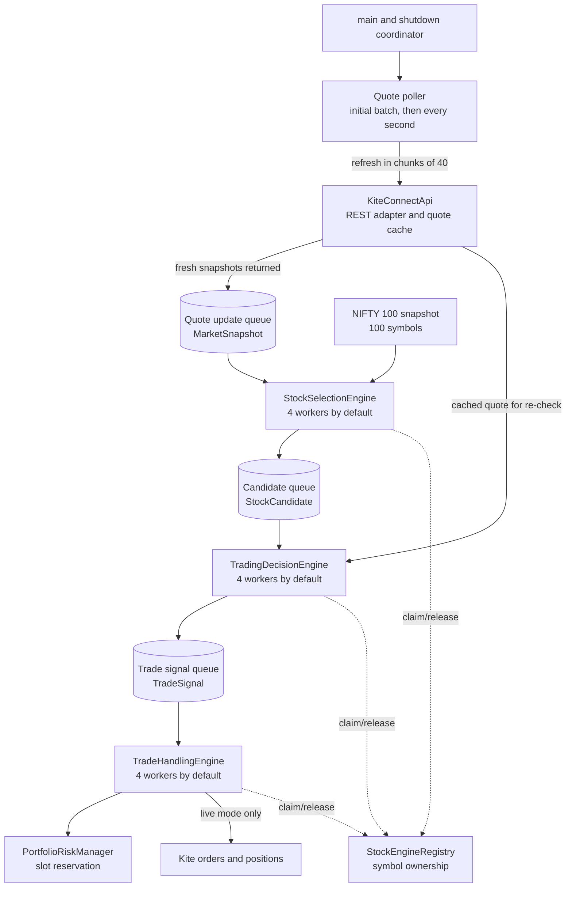
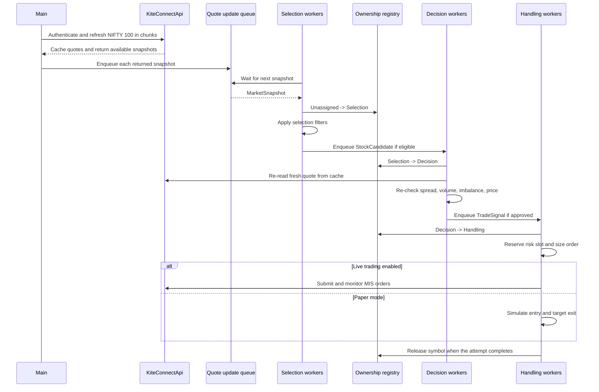

# High-Level Design

**Project:** ZeroTick-Systems  
**Status:** Prototype  
**Design snapshot:** 2026-11-19

## 1. Purpose and scope

ZeroTick-Systems is a Windows C++ application that retrieves NSE market data
from Zerodha Kite Connect, filters a configured stock universe, evaluates
potential long entries, optionally submits and manages MIS orders, and
supports a separate historical-candle backtest mode.

This document describes the event-driven runtime wired by `src/main.cpp`:
quote delivery, stock selection, trade decisions, and trade handling.

The application is a prototype, not a production trading system. Live orders
are opt-in, and live-market behavior, exchange-hour handling, and complete
operational recovery have not been comprehensively validated.

## 2. System context


The executable runs on Windows and uses WinHTTP for HTTPS, Windows sockets
for the local authentication callback, CNG for the login checksum, and
`nlohmann/json` for JSON parsing. Credentials are loaded locally; they must
not be committed or printed in logs.

## 3. Runtime architecture



The quote poller is the market-data producer. Selection workers block on the
quote-update queue and evaluate a symbol only when a snapshot arrives. Decision
and handling workers block on their respective work queues when no candidate or
signal is available.

## 4. End-to-end flow



After startup, the poller sleeps for one second, refreshes the same universe in
chunks, and publishes only snapshots returned by the quote endpoint. Missing
instruments are not put on the selection queue. The API cache and update queue
serve different purposes: the queue drives selection, while the cache supplies
the decision engine's final quote check.

## 5. Concurrency and ownership

Each engine starts four worker threads by default. Workers within an engine
share a blocking multi-producer/multi-consumer queue; the thread count is
configurable. There is also a quote-polling thread and the main shutdown loop.

The registry enforces one active engine per symbol:

```text
Unassigned -> Selection -> Decision -> Handling -> Unassigned
```

A worker must claim the expected owner before acting. Rejected candidates,
failed quote checks, and completed or abandoned handling attempts release
ownership. This prevents two engine stages from processing the same symbol at
the same time.

## 6. Selection and decision algorithms

The selection and decision stages are long-only gates: selection narrows fresh
market snapshots to candidates, then decision rechecks each candidate before
creating a buy signal. Neither stage submits orders; execution and risk checks
remain in `TradeHandlingEngine`.

### Stock selection

Selection ignores snapshots older than five seconds and applies these default
filters in order:

| Gate | Default |
|---|---:|
| Last price must be greater than the minimum | 100 |
| Symbol must belong to the configured universe | NIFTY 100 required |
| Cumulative session volume | At least 50,000 |
| Relative volume | At least 1.5 |
| Best bid/ask spread | No more than 0.20% |
| Displayed bid and ask depth | At least 1,000 on each side |
| Change from previous newer quote | At least +0.05% |
| Intraday high/low range | 0.30% to 6.0% |
| Absolute change from previous quote | No more than 6.0% |

The volume baseline is an EWMA of cumulative quote-volume samples with
`alpha = 0.2`:

```text
average_t      = 0.2 * volume_t + 0.8 * average_(t-1)
relativeVolume = volume_t / average_t
```

The current sample is included in the EWMA before computing the ratio, so the
first sample has relative volume 1.0. This is a comparison of successive
cumulative-volume snapshots, not a time-normalized or historical-volume
profile.

Price movement is computed from the last price and receipt time of the
previous newer quote for that symbol:

```text
priceChangePercent = (last_t - last_(t-1)) / last_(t-1) * 100
rangePercent       = (high - low) / low * 100
spreadPercent      = (ask - bid) / ((ask + bid) / 2) * 100
```

The first valid quote seeds the price baseline and cannot pass the +0.05%
movement gate by itself. A newer quote advances the baseline even when another
selection filter rejects it; an out-of-order quote cannot move that baseline
backward. A candidate is sent to decision only after all selection gates pass.

### Trade decision

For each candidate, decision reads a cached quote no older than five seconds
and requires:

- Fresh spread no greater than **0.10%**.
- Candidate relative volume of at least **1.2** when volume confirmation is
  enabled (enabled by default).
- Weighted bid-side imbalance of at least **+0.05**.
- Fresh last price not below the candidate's selected price.

The five-level imbalance weights nearer levels more heavily:

```text
imbalance = (sum(weight_i * bidQty_i) - sum(weight_i * askQty_i))
            / sum(weight_i * (bidQty_i + askQty_i))
weights   = [1.0, 0.8, 0.6, 0.4, 0.2]
```

If these checks pass, decision creates a long `TradeSignal`; it does not place
an order. Tick size is inferred from adjacent depth prices, with `0.01` as a
fallback. The entry trigger is one tick above the rounded-up greater of last
price and best ask; the limit is one more tick above the trigger. Defaults set
the target to **+0.40%** and the stop to **-0.20%** from the entry limit.
Decision attaches an indicative quantity based on a fixed 50,000 budget;
handling recalculates quantity against the portfolio slot and may reject it.

The current decision stage evaluates one fresh quote per candidate; it does
not wait for multiple-snapshot confirmation.

### Historical backtest mode

`--backtest YYYY-MM-DD` downloads one-minute OHLCV candles for the configured
NIFTY 100 symbols using Kite's historical API, then replays the available
selection and decision rules with default capital of 10,000. The NSE
instrument dump supplies instrument tokens and tick sizes. Trade details are
printed as an aligned console table, followed by a summary whose final line is
the total profit or loss.

This is not a full-depth replay: candles contain no historical spread, depth,
or five-level imbalance, so those gates are omitted. Signals are evaluated at
bar close, entries are tested against the next one-minute bar, ambiguous
stop/target bars assume stop-first, and remaining positions close at the end
of the day. The next-bar entry window differs from the live 30-second timeout.
Fees and slippage are excluded. The backtest uses the current NIFTY 100 list
for earlier dates and may therefore have survivorship bias. Backtest mode
cannot submit live orders.

`--optimize-100-days` fetches the latest 100 completed sessions in weekly
chunks and evaluates 20 predefined selection/exit combinations. The first 70
sessions are used for ranking; the last 30 are reported as holdout results.
This is a bounded diagnostic sweep, not a guarantee of profitability.

## 7. Trading modes and safety boundary

- **Default mode:** `liveTrading` is false; no broker orders are submitted by
  `TradeHandlingEngine`.
- **Live mode:** `--enable-live-trading` enables real Kite MIS order submission.
  Startup checks for existing MIS positions and open orders, reads available
  cash, and applies an in-memory maximum of ten reserved position slots.
- The application monitors target and stop conditions in-process. These are
  not broker-hosted OCO/bracket protections; a crash, network issue, or
  shutdown can leave broker state requiring manual review.
- The portfolio guard is an in-memory cap, not a daily-loss limit or a durable
  order ledger.

## 8. Deployment and build

The current transport is Windows-only and uses C++14. CMake fetches
`nlohmann/json`.

```powershell
cmake -S . -B build
cmake --build build --config Release
ctest --test-dir build -C Release --output-on-failure
```

Run from the repository root so `.env` can be loaded:

```powershell
.\build\Release\zerotick.exe
```

`--login` forces a fresh browser login. `--enable-live-trading` is a separate
explicit option that can submit real orders.

## 9. Current limitations

- The NIFTY 100 membership is a checked-in snapshot sourced from the NSE list
  dated 2026-11-19; it does not refresh automatically on index rebalance.
- There is no market-hours or holiday gate. A REST response timestamp reflects
  when the application received the quote, not necessarily when the exchange
  last changed the market data.
- The relative-volume filter compares cumulative volume with an EWMA updated
  on each quote event. This can stay near 1.0 when volume is not increasing.
- Quote-to-quote movement uses local receipt order, not exchange event time.
- Paper and live behavior are covered by fakes/unit tests, not by a complete
  market replay or end-to-end live-order validation.
- The previous per-symbol worker pipeline has been removed. The active runtime
  is the selection, decision, and handling pipeline described above.

## 10. Related documents

- [Low-Level Design](./Low%20Level%20Design.md)
