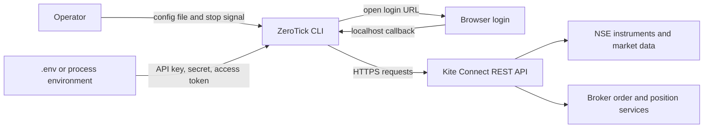
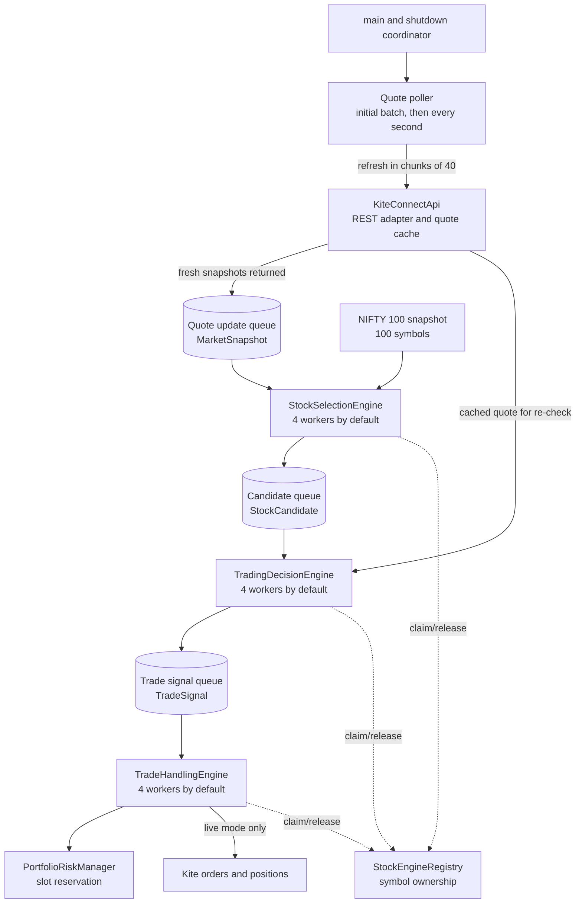
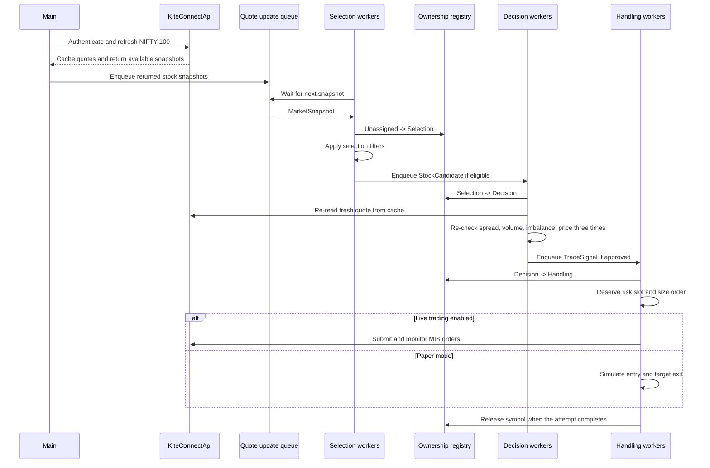

# High-Level Design

**Project:** ZeroTick-Systems  
**Status:** Prototype  
**Design snapshot:** 2026-11-22

## 1. Purpose and scope

ZeroTick-Systems is a Windows C++ application that retrieves NSE market data
from Zerodha Kite Connect, filters a configured stock universe, evaluates
potential long and short entries, optionally submits and manages MIS orders,
records structured shadow-live events, and supports historical replay and
parameter-study modes.

This document describes the event-driven runtime wired by `src/main.cpp`:
quote delivery, stock selection, trade decisions, and trade handling.

The application is a prototype, not a production trading system. Live orders
are opt-in, and live-market behavior, exchange-hour handling, and complete
operational recovery have not been comprehensively validated.

## 2. System context



The executable runs on Windows and uses WinHTTP for HTTPS, Windows sockets
for the local authentication callback, CNG for the login checksum, and
`nlohmann/json` for JSON parsing. Credentials are loaded locally; they must
not be committed or printed in logs.

Algorithm settings are loaded at startup from `config.json` in the working
directory, or from the file supplied with `--config <path>`. The file controls
selection and decision thresholds, volume smoothing and book-imbalance
weights, quote freshness, tick offsets,
target/stop percentages, worker and polling settings, position and paper-cash
limits, short-selling opt-in, and backtest execution/cost assumptions. Invalid
or unknown settings stop startup with an error. Editing the file takes effect
on the next executable start and does not require rebuilding. Only
`--config <path>` remains as a command-line override; real order submission
requires both `run.mode: "live"` and `run.live_trading_confirmed: true`.

## 3. Runtime architecture



The quote poller is the market-data producer. Selection workers block on the
quote-update queue and evaluate a symbol only when a snapshot arrives. Decision
and handling workers block on their respective work queues when no candidate or
signal is available.

## 4. End-to-end flow



After startup, the poller sleeps for one second, refreshes the same universe in
chunks, and publishes only snapshots returned by the quote endpoint. Missing
instruments are not put on the selection queue. The API cache and update queue
serve different purposes: the queue drives selection, while the cache supplies
the decision engine's final quote check.

## 5. Concurrency and ownership

Each engine starts four worker threads by default. Workers within an engine
share a blocking multi-producer/multi-consumer queue; the thread count is
configurable. There is also a quote-polling thread and the main shutdown loop.

The registry enforces one active engine per symbol:

```text
Unassigned -> Selection -> Decision -> Handling -> Unassigned
```

A worker must claim the expected owner before acting. Rejected candidates,
failed quote checks, and completed or abandoned handling attempts release
ownership. This prevents two engine stages from processing the same symbol at
the same time.

## 6. Selection and decision algorithms

Selection narrows fresh market snapshots to directional candidates, then
decision rechecks each candidate before creating a long or short signal.
Short selling is disabled unless opted in through `allow_short_selling` in the
runtime config. Neither stage submits orders; execution and risk checks remain
in `TradeHandlingEngine`.

### Stock selection

Selection ignores snapshots older than five seconds and applies these default
filters in order:

| Gate | Default |
|---|---:|
| Last price must be greater than the minimum | 100 |
| Symbol must belong to the configured universe | NIFTY 100 required |
| Cumulative session volume | At least 50,000 |
| Relative volume | At least 1.2 |
| Best bid/ask spread | No more than 0.03% |
| Displayed bid and ask depth | At least 1,000 on each side |
| 30-second directional momentum | At least 0.12% in the selected direction |
| 120-second trend alignment | At least 0.06% in the selected direction |
| Intraday high/low range | 0.30% to 6.0% |
| Absolute change from previous quote | No more than 6.0% |

The volume baseline is an EWMA of volume added between consecutive quote
samples with configurable `alpha` (default `0.2`):

```text
intervalVolume = cumulativeVolume_t - cumulativeVolume_(t-1)
average_t      = 0.2 * intervalVolume + 0.8 * average_(t-1)
relativeVolume = intervalVolume / average_t
```

The first cumulative sample establishes a baseline with relative volume 1.0
and is not inserted as an interval. A session-volume reset establishes a new
baseline. This measures activity between polls; it is not a historical
time-of-day volume profile.

Price movement is computed from timestamped per-symbol history. The checked-in
profile compares the latest price with 30-second and 120-second references:

```text
momentumPercent    = (last_t - last_(t-30s)) / last_(t-30s) * 100
trendPercent       = (last_t - last_(t-120s)) / last_(t-120s) * 100
rangePercent       = (high - low) / low * 100
spreadPercent      = (ask - bid) / ((ask + bid) / 2) * 100
```

History is bounded to the longest configured lookback plus a small margin.
Quotes cannot qualify until both references exist. A newer quote advances
history even when another selection filter rejects it; an out-of-order quote
cannot move history backward. A candidate is sent to decision only after all
selection gates pass.
Upward momentum produces a long candidate. Downward momentum produces a short
candidate only when short selling is explicitly enabled.

### Trade decision

For each candidate, decision requires three newer cached-quote confirmations
at the configured interval. Each quote must be no older than five seconds and
must satisfy:

- Fresh spread no greater than **0.03%**.
- Candidate relative volume of at least **1.5** when volume confirmation is
  enabled (enabled by default).
- Long: weighted bid-side imbalance at least **+0.15** and fresh price not
  below the selected price.
- Short (explicit opt-in): weighted imbalance at most **-0.15** and fresh
  price not above the selected price.

The five-level imbalance weights nearer levels more heavily; each weight is
configurable:

```text
imbalance = (sum(weight_i * bidQty_i) - sum(weight_i * askQty_i))
            / sum(weight_i * (bidQty_i + askQty_i))
weights   = [1.0, 0.8, 0.6, 0.4, 0.2]
```

If these checks pass, decision creates a directional `TradeSignal`; it does
not place an order. Tick size is inferred from adjacent depth prices, with a
configurable `0.01` fallback. Entry trigger and limit offsets are configurable
in ticks. Long entries trigger above the ask and target higher;
short entries trigger below the bid and target lower. The checked-in target is
0.50% and the stop is 0.25%, mirrored around entry. Decision attaches an indicative
quantity based on a configurable 50,000 budget; handling recalculates quantity
against the portfolio slot and may reject it.

### Historical backtest mode

With `run.mode: "backtest"`, `main` downloads one-minute OHLCV candles for the
configured NIFTY 100 universe. Each source
minute is normally expanded into a deterministic 60-event path that preserves
its OHLC and total volume. This makes second-based momentum, confirmation,
entry timeout, and maximum-holding rules comparable with the live strategy;
it does not reconstruct the unknowable true tick path.

Historical candles contain no order book. Displayed depth and five-level
imbalance are therefore omitted, while spread is estimated from a configurable
base plus candle volatility and capped at a configured maximum. The estimate
participates in both liquidity filtering and executable bid/ask prices.
Pending stop-limit entries expire after the configured seconds; target, stop,
momentum reversal, and maximum holding time manage filled positions. Ambiguous
stop/target bars remain conservative (stop first).

The simulator deducts configured brokerage, sell-side STT, exchange and SEBI
charges, buy-side stamp duty, and GST. It reports gross P&L, charges, and net
P&L separately. Additional slippage, historical depth, and exact queue
position are not modeled. Current NIFTY 100 membership is reused for earlier
dates and can introduce survivorship bias.

`run.mode: "optimize_100_days"` uses the same execution and cost model while
evaluating the bounded train/holdout parameter study. Neither
historical mode can submit broker orders.

## 7. Trading modes and safety boundary

- **Paper/shadow mode:** no broker orders are submitted by
  `TradeHandlingEngine`; shadow mode records structured JSONL events.
- **Live mode:** `run.mode: "live"` enables real Kite MIS order submission only
  when `run.live_trading_confirmed` is also true.
  Startup checks for existing MIS positions and open orders, reads available
  cash, and applies the configured maximum reserved position slots (20 in the
  checked-in profile).
- The application monitors target and stop conditions in-process. These are
  not broker-hosted OCO/bracket protections; a crash, network issue, or
  shutdown can leave broker state requiring manual review.
- The portfolio guard is an in-memory cap, not a daily-loss limit or a durable
  order ledger.

## 8. Deployment and build

The current transport is Windows-only and uses C++14. CMake fetches
`nlohmann/json`.

```powershell
cmake -S . -B build
cmake --build build --config Release
ctest --test-dir build -C Release --output-on-failure
```

Run from the repository root so `.env` can be loaded:

```powershell
.\build\Release\zerotick.exe
```

Runtime behavior belongs in `config.json`; only `--config <path>` is accepted
as a command-line override. Set `run.force_login` to force browser login.

## 9. Offline ML research pipeline

Shadow-live JSONL is the source for a separate Python research subsystem. Its
three stages are: causal replay of sampled five-level depth with Optuna
strategy tuning; XGBoost meta-label training to accept or reject an existing
directional candidate; and joint strategy/probability-threshold optimization.

The subsystem is deliberately outside the execution process. It cannot submit
orders or rewrite runtime configuration. Suggested configurations, models,
chronological split metadata, metrics, and trial histories are emitted under
`ml/artifacts/` for review. Training requires completed shadow trades, while
replay requires timestamped `market_snapshot` events with five bid and ask
levels. Train, validation, and final test sessions remain chronologically
separated.

## 10. Historical ML dataset and validation boundary

`export_backtest_data` is a non-trading run mode that downloads the latest
configured number of completed sessions and writes schema-v1 JSONL. Records
are grouped by symbol/session and retain ordered one-minute OHLCV plus tick
size. The older sessions are labeled `train`; the later sessions are labeled
`validation` in the manifest and every record. Output is staged as `.partial`
and published only after a completion marker.

The historical Python workflow mirrors the three shadow research phases:
candle-strategy Optuna tuning, XGBoost candidate-quality training, and
model-assisted tuning. Development-fit and development-validation both come
only from the first 100 sessions. The following 100 sessions remain outside
all fitting and parameter selection and are evaluated once after freezing the
result. Historical and shadow models are separate because candles cannot
provide genuine depth imbalance, queue position, or observed spread.

## 11. Current limitations

- The NIFTY 100 membership is a checked-in snapshot sourced from the NSE list
  dated 2026-11-19; it does not refresh automatically on index rebalance.
- There is no market-hours or holiday gate. A REST response timestamp reflects
  when the application received the quote, not necessarily when the exchange
  last changed the market data.
- The relative-volume filter compares volume added between polls with an EWMA
  of prior intervals; it is sensitive to polling cadence and is not normalized
  against a historical time-of-day profile.
- Quote-to-quote movement uses local receipt order, not exchange event time.
- Paper and live behavior are covered by fakes/unit tests, not by a complete
  market replay or end-to-end live-order validation.
- The previous per-symbol worker pipeline has been removed. The active runtime
  is the selection, decision, and handling pipeline described above.

## 12. Related documents

- [Low-Level Design](./Low%20Level%20Design.md)
- [ML pipeline](../ml/README.md)
