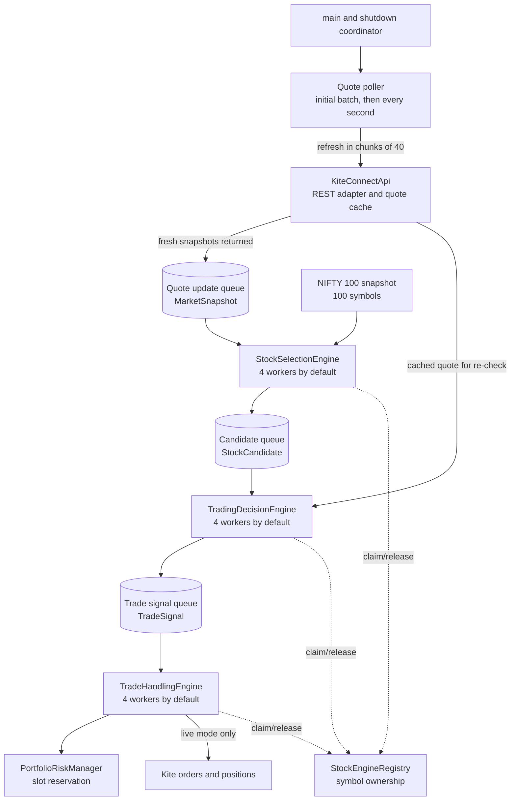
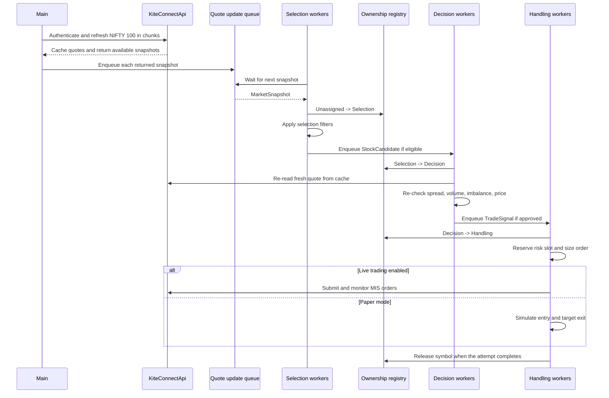

# High-Level Design

**Project:** ZeroTick-Systems  
**Status:** Prototype  
**Design snapshot:** 2026-11-19

## 1. Purpose and scope

ZeroTick-Systems is a Windows C++ application that retrieves NSE market data
from Zerodha Kite Connect, filters a configured stock universe, evaluates
potential long entries, and optionally submits and manages MIS orders.

This document describes the runtime wired by `src/main.cpp`. The older
`Worker`/`ThreadPool` strategy path remains in the library and is exercised by
some strategy tests, but it is not instantiated by the current application
entry point.

The application is a prototype, not a production trading system. Live orders
are opt-in, and live-market behavior, exchange-hour handling, and complete
operational recovery have not been comprehensively validated.

## 2. System context


The executable runs on Windows and uses WinHTTP for HTTPS, Windows sockets
for the local authentication callback, CNG for the login checksum, and
`nlohmann/json` for JSON parsing. Credentials are loaded locally; they must
not be committed or printed in logs.

## 3. Runtime architecture



The quote poller is the market-data producer. Selection workers block on the
quote-update queue and evaluate a symbol only when a snapshot arrives. Decision
and handling workers block on their respective work queues when no candidate or
signal is available.

## 4. End-to-end flow



After startup, the poller sleeps for one second, refreshes the same universe in
chunks, and publishes only snapshots returned by the quote endpoint. Missing
instruments are not put on the selection queue. The API cache and update queue
serve different purposes: the queue drives selection, while the cache supplies
the decision engine's final quote check.

## 5. Concurrency and ownership

Each engine starts four worker threads by default. Workers within an engine
share a blocking multi-producer/multi-consumer queue; the thread count is
configurable. There is also a quote-polling thread and the main shutdown loop.

The registry enforces one active engine per symbol:

```text
Unassigned -> Selection -> Decision -> Handling -> Unassigned
```

A worker must claim the expected owner before acting. Rejected candidates,
failed quote checks, and completed or abandoned handling attempts release
ownership. This prevents two engine stages from processing the same symbol at
the same time.

## 6. Trading modes and safety boundary

- **Default mode:** `liveTrading` is false; no broker orders are submitted by
  `TradeHandlingEngine`.
- **Live mode:** `--enable-live-trading` enables real Kite MIS order submission.
  Startup checks for existing MIS positions and open orders, reads available
  cash, and applies an in-memory maximum of ten reserved position slots.
- The application monitors target and stop conditions in-process. These are
  not broker-hosted OCO/bracket protections; a crash, network issue, or
  shutdown can leave broker state requiring manual review.
- The portfolio guard is an in-memory cap, not a daily-loss limit or a durable
  order ledger.

## 7. Deployment and build

The current transport is Windows-only and uses C++14. CMake fetches
`nlohmann/json`.

```powershell
cmake -S . -B build
cmake --build build --config Release
ctest --test-dir build -C Release --output-on-failure
```

Run from the repository root so `.env` can be loaded:

```powershell
.\build\Release\zerotick.exe
```

`--login` forces a fresh browser login. `--enable-live-trading` is a separate
explicit option that can submit real orders.

## 8. Current limitations

- The NIFTY 100 membership is a checked-in snapshot sourced from the NSE list
  dated 2026-11-19; it does not refresh automatically on index rebalance.
- There is no market-hours or holiday gate. A REST response timestamp reflects
  when the application received the quote, not necessarily when the exchange
  last changed the market data.
- The relative-volume filter compares cumulative volume with an EWMA updated
  on each quote event. This can stay near 1.0 when volume is not increasing.
- Paper and live behavior are covered by fakes/unit tests, not by a complete
  market replay or end-to-end live-order validation.
- Several older strategy/worker components remain compiled, so the active
  runtime should be traced from `src/main.cpp` rather than inferred from every
  source file in the library.

## 9. Related documents

- [Low-Level Design](./Low%20Level%20Design.md)
